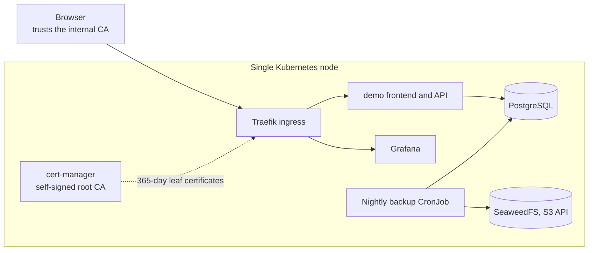

# Single-node Kubernetes platform

[](https://github.com/Walaskien/single-node-k8s-platform/actions/workflows/ci.yml)

A small lab of a single-node Kubernetes setup for an internal application: private CA with
cert-manager, TLS ingress on internal hostnames, PostgreSQL with a nightly backup to S3-compatible storage,
Grafana and metrics-server. It runs on k3d, so it starts on a laptop with `make up`.

The setup it is modelled on is upstream Kubernetes installed with `kubeadm` on one Rocky
Linux node (containerd, flannel, HAProxy Ingress, local-path storage). That part is only
documented and scripted, see [Lab versus kubeadm](#lab-versus-kubeadm).

```console
make up      # create the k3d cluster and deploy everything
make status  # pods, ingress hostnames, certificate state
make smoke   # curl both demo hostnames over the internal CA
make backup-test  # run a backup, restore it into a scratch database, compare row counts
make down    # delete the cluster
```

## How it fits together



More detail and the reasoning behind the choices: [`docs/architecture.md`](docs/architecture.md).

| Layer | Component | Notes |
|---|---|---|
| Cluster | k3d (k3s in Docker) | the kubeadm node is described in `docs/kubeadm-node.md` |
| Ingress | Traefik (bundled with k3s) | hostname routing, CORS middleware |
| PKI | cert-manager, self-signed root | 10-year root, 365-day leaf certificates |
| Database | PostgreSQL 17 (StatefulSet) | one replica, 2 Gi volume |
| Backups | CronJob, `pg_dump` to the S3 service | 02:00 daily, keeps the last 14, checks the dump before upload |
| Object storage | SeaweedFS (single process) | S3 API for backups; MinIO images are no longer published |
| Observability | metrics-server, Grafana | no Prometheus or alerting |
| Demo app | static frontend + API | two hostnames, to exercise TLS and CORS |

## Continuous integration

[`.github/workflows/ci.yml`](.github/workflows/ci.yml) runs on every push and pull request:

- **validate**: `yamllint`, `kubeconform` (core objects strictly; CRDs without a bundled
  schema, such as cert-manager and Traefik, are skipped) and `ansible-lint` on the playbook.
- **e2e**: creates a k3d cluster, runs `make up`, then `make smoke` (both demo hostnames
  served over the internal CA) and `make backup-test` (backup, restore into a scratch
  database, row count compared).

The CI job does not run the Ansible playbook.

## Lab versus kubeadm

The kubeadm node needs a whole host (swap off, kernel modules), so the lab uses k3d: one
container stands in for the node, and pods still run on containerd. The manifests in
`platform/` and `apps/` are plain Kubernetes objects. What differs is the ingress controller
(Traefik in the lab, HAProxy Ingress on the node), the CNI and the storage class. The list
and the manual `kubeadm` steps are in [`docs/kubeadm-node.md`](docs/kubeadm-node.md); the
same steps as a playbook are in [`ansible/`](ansible/).

## Requirements

Docker or Colima, `k3d`, `kubectl`, `helm`, `make`.

```console
brew install k3d kubectl helm colima docker
colima start --cpu 4 --memory 4 --disk 20
```

It was run on an 8 GB MacBook Air with a 4 GB Colima VM. `make up` takes about five minutes
on a cold image cache, mostly pulling images. The hostnames are `*.example.internal`;
`make hosts` prints the `/etc/hosts` line and the URL (port 8443).

## Certificates and trust

The root CA is self-signed, so browsers do not trust it until you install it:

```console
make trust-ca    # writes internal-root-ca.pem and prints install commands
```

Leaf certificates are valid for 365 days. A 10-year leaf certificate from a private CA was
rejected by Apple clients even though the CA was trusted, so the leaves here stay well under
Apple's documented validity limits. Details, and a correction about which limit applies to
private CAs, are in [apple-tls-398](https://github.com/Walaskien/apple-tls-398).

## Layout

```
cluster/        k3d cluster definition and port mappings
platform/       cert-manager issuers, PostgreSQL, S3 (SeaweedFS), Grafana
apps/demo/      sample frontend and API with Ingress and Certificates
tests/          restore test job used by `make backup-test`
ansible/        kubeadm node as a playbook (not run end to end)
docs/           architecture, runbook, kubeadm node, dual-homed node
```

## Limitations

- One node: node loss means downtime, and local-path volumes go with the node.
- Secrets in the manifests are literal demo passwords. Do not reuse them.
- The restore test is a manual and CI check of one table (`backup_probe`), not a regular
  drill of a real database.
- The Ansible roles are linted but have not been run against a host, so treat them as a
  starting point and try them on a spare Rocky Linux VM.
- Observability is Grafana and metrics-server only.

## Documentation

- [`docs/architecture.md`](docs/architecture.md): components, trade-offs of one node, what to change when it outgrows it
- [`docs/runbook.md`](docs/runbook.md): backup and restore, certificates, common failures
- [`docs/kubeadm-node.md`](docs/kubeadm-node.md): the kubeadm node and how it differs from the lab
- [`docs/dual-homed-node.md`](docs/dual-homed-node.md): a node with two interfaces answering on the wrong one

## What I would improve next

- Run the Ansible roles against a disposable VM in CI.
- Prometheus and alerting.
- Replace the committed demo secrets with Sealed Secrets or External Secrets.

## License

MIT, see [LICENSE](LICENSE).
